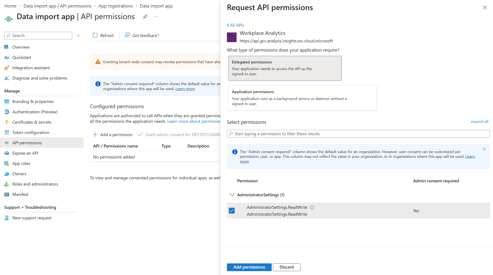
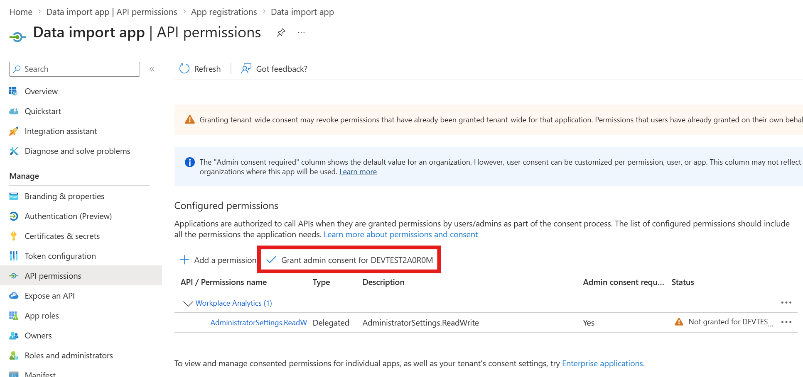
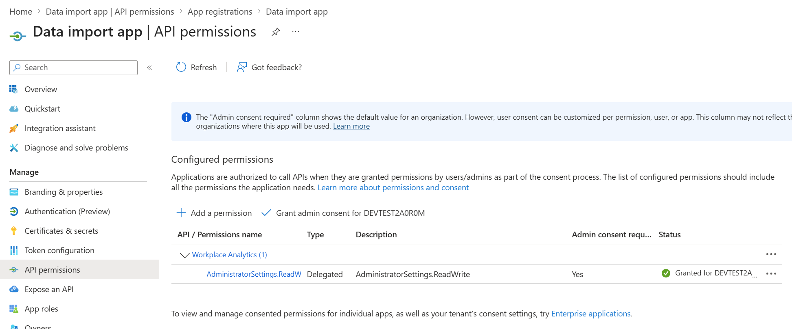
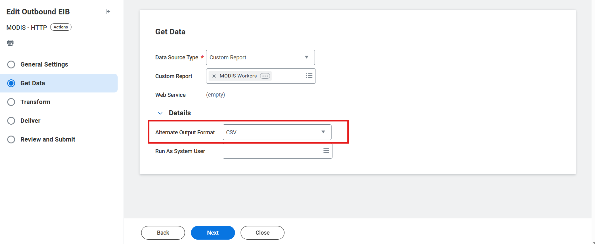

# OAuth Token Generator for HRIS Integration

This tool generates OAuth access tokens and refresh tokens for integrating your HRIS system with _Org data in M365_ API using Azure AD authentication.

## Prerequisites

- **Node.js (v16 or higher)** and **npm** installed
  - Download from: https://nodejs.org/ (npm is included with Node.js)
  - Verify installation: `node --version` and `npm --version`
- Access to Azure Portal with permissions to create/modify app registrations
- Admin consent capability (or request admin to grant consent)

## Step 1: Azure AD App Registration Setup

### 1.1 Create or Navigate to Your App Registration

1. Go to [Azure Portal](https://portal.azure.com)
2. Navigate to **Azure Active Directory** > **App registrations**
3. Find your app (e.g., "Data import app") or click **+ New registration** to create one


### 1.2 Note Your Application Details

From the **Overview** page, copy and save:
- **Application (client) ID** - You'll need this to run the program
- **Directory (tenant) ID** - You'll need this to run the program


### 1.3 Create a Client Secret

1. In your app registration, click **Certificates & secrets** in the left menu
2. Click **+ New client secret**
3. Add a description (e.g., "HRIS Integration Secret")
4. Choose an expiration period
5. Click **Add**
6. **IMPORTANT:** Copy the **Value** immediately - you won't be able to see it again!


### 1.4 Configure Redirect URI

1. Click **Authentication** in the left menu
2. Under **Platform configurations**, click **+ Add a platform**
3. Select **Web**
4. Enter the redirect URI: `http://localhost:5173/callback`
5. Click **Configure**


### 1.5 Add Workplace Analytics API Permission

1. Click **API permissions** in the left menu
2. Remove any existing permissions by clicking on the three dots on the right of the row(s) > **Remove permission(s)**
3. Click **+ Add a permission**
4. Select **APIs my organization uses** tab
5. Search for **"Workplace Analytics"**
6. Select the API from the results
7. Select **Delegated permissions**
8. Check the required permission:
   - **AdministratorSettings.ReadWrite** (or the appropriate permission for your use case)
9. Click **Add permissions**



### 1.6 Grant Admin Consent

1. Back on the **API permissions** page
2. You should now see:
   - **Workplace Analytics** permission (AdministratorSettings.ReadWrite)
3. Click **Grant admin consent for [your tenant name]**
4. Click **Yes** to confirm



✅ The **Status** column should now show "Granted for [tenant name]" with a green checkmark



## Step 2: Get _Org data in M365_ Connector Details

Before running the program, you'll need to collect two pieces of information from _Org data in M365_:

### 2.1 Get Connector ID

1. Log in to  [**_Org data in M365_**](https://admin.cloud.microsoft/?#/featureexplorer/migration/OrganizationalDataInM365)
2. Navigate to your **API-based connector page**
3. Look at the **URL** in your browser's address bar
4. The **Connector ID** is visible in the URL


**Example URL:**
```
https://admin.cloud.microsoft/#/featureexplorer/migration/OrganizationalDataInM365/connection-details/b37fc3a0-e438-47e7-ab68-ea0471842493
```
In this example, the Connector ID is: `b37fc3a0-e438-47e7-ab68-ea0471842493`

### 2.2 Get Nova Scale Unit

1. In **_Org data in M365_**, navigate to your **API-based connector _setup_** (Data Connections > New Import)
2. Go to step 2: "Prepare data"
3. Find your scale unit at the bottom


**Example value:**
```
novaprdcusz-01
```

**💡 Tip:** Keep these values handy - the program will ask for them when you run it.

---

## Step 3: Install Dependencies

Open PowerShell or Command Prompt in the script directory and run:

```powershell
npm run setup
```

Or, more directly, run:
```powershell
npm install express open node-fetch@2 crypto-js readline-sync
npm install --save-dev @types/express @types/node @types/node-fetch @types/readline-sync typescript
```


## Step 4: Compile the TypeScript Code

```powershell
npm run build
```

Or, more directly, run:
```powershell
npx tsc oauth-auth-code.ts --esModuleInterop
```

## Step 5: Run the Program

```powershell
npm start
```

Or, more directly, run:
```powershell
node oauth-auth-code.js
```

### Program Workflow

1. **Initial Prompts**: The program will show prerequisites and ask for confirmation
2. **Enter Azure AD Credentials**: You'll be prompted to enter:
   - Client ID
   - Client Secret (hidden input)
   - Tenant ID
3. **Enter _Org data in M365_ Connector Details**: You'll be prompted to enter:
   - Connector ID (from _Org data in M365_ API connector URL)
   - Nova Scale Unit (from _Org data in M365_ API connector setup)
4. **Browser Opens**: The program starts a local server and opens your browser
5. **Sign In**: Sign in with your Azure AD account
6. **Consent**: Grant permissions if prompted
7. **Configuration Generated**: After successful authentication, complete configuration is displayed

### Output

The program will display a **complete HRIS configuration** including:
- **HTTP Address**: Fully formatted _Org data in M365_ API endpoint with your Connector ID and Scale Unit
- **Web Service Invocation Type**: OAuth 2.0
- **Access Token**: Full JWT token
- **Refresh Token**: Full refresh token string
- **Refresh Token URL**: Formatted with your Tenant ID
- **Client ID**: Your application client ID
- **Client Secret**: Your client secret value

All values are displayed in both the terminal and browser for easy copying! 📋

## Step 6: Configure your HRIS Integration

These instructions are for a Workday EIB integration.

### 6.1 Set Alternative Output Format

1. In your Workday EIB, go to the **Get Data** section
2. Set **Alternative Output Format** to **CSV** in **Details**
3. Configure your CSV format settings as needed



### 6.2 Configure Delivery Method

1. Go to the **Deliver** section
2. Select delivery method: **HTTP/SSL**
3. Set **Delivery Details (HTTPS)** tab

**Simply copy the values from the program output:**

The program generates all the configuration values you need! Just copy them directly from the terminal or browser window.

| Field | Description |
|-------|-------------|
| **HTTP Address** | The complete _Org data in M365_ API endpoint (automatically generated with your Tenant ID, Connector ID, and Scale Unit) |
| **Web Service Invocation Type** | OAuth 2.0 |
| **Access Token** | Copy from program output |
| **Refresh Token** | Copy from program output |
| **Refresh Token URL** | Copy from program output (includes your Tenant ID) |
| **Client ID** | Copy from program output |
| **Client Secret** | Copy from program output |


**Example Configuration Display:**

```
═══════════════════════════════════════════════════════════════════════════════
                     CONFIGURATION - COPY THESE VALUES               
═══════════════════════════════════════════════════════════════════════════════

📋 Use these values in your HRIS Integration OAuth 2.0 configuration:

┌─────────────────────────────────────────────────────────────────────────────┐
│ HTTP Address (Org data in M365 API Endpoint)                              │
└─────────────────────────────────────────────────────────────────────────────┘
https://api.orginsights.viva.office.com/v1.0/tenants/YOUR-TENANT-ID/modis/connectors/HR/ingestions/fileIngestion?connectorId=YOUR-CONNECTOR-ID&novascaleunit=YOUR-SCALE-UNIT

┌─────────────────────────────────────────────────────────────────────────────┐
│ Web Service Invocation Type                                                 │
└─────────────────────────────────────────────────────────────────────────────┘
OAuth 2.0

... (all other values displayed)
```


**Important Notes:**
- The Refresh Token URL must use your specific **tenant ID**, not `/common/`
- Copy the full access token and refresh token from the program output
- Ensure there are no extra spaces when pasting the tokens

## Troubleshooting

### Error: "Need admin approval"

**Solution**: An admin needs to grant consent for the API permissions. Go to Azure Portal > App registrations > API permissions > Grant admin consent.

### Error: "Invalid resource"

**Solution**: The API permission is not added to your app registration. Follow Step 1.5 again to add the correct API permission.

### Error: "Redirect URI mismatch"

**Solution**: Ensure `http://localhost:5173/callback` is added as a redirect URI in Azure Portal > App registrations > Authentication.

### Error: "Unauthorized" / HTTP 403 in your HRIS integration

**Solution**: 
- Verify the tokens are not expired
- Check the refresh token URL uses your specific tenant ID (not `/common/`)
- Ensure API permissions include the correct scope for the Viva Insights API
- Make sure the email/UPN entered as the credential of the _Org data in M365_ API-based connector matches the email used to login when running this script to retrieve tokens

## Additional Resources

- [Microsoft Identity Platform Documentation](https://docs.microsoft.com/en-us/azure/active-directory/develop/)
- [OAuth 2.0 Authorization Code Flow](https://docs.microsoft.com/en-us/azure/active-directory/develop/v2-oauth2-auth-code-flow)
- [Workday Integration Documentation](https://community.workday.com/)

## Notes

- **Token Expiration**: Access tokens typically expire after 1 hour. Your HRIS integration should automatically use the refresh token to get new access tokens and store it for the next process.
