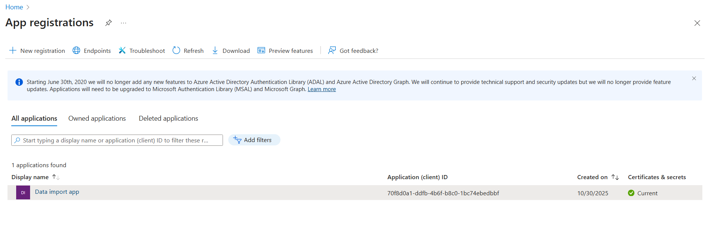
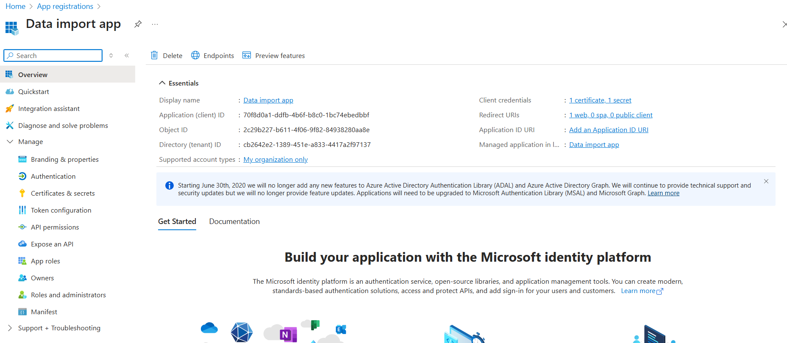
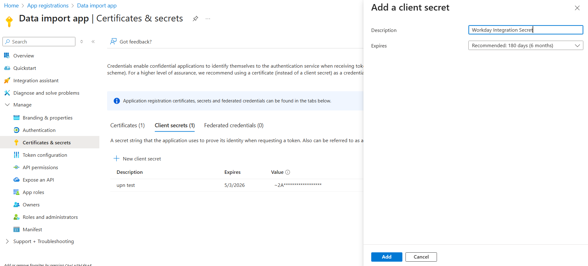
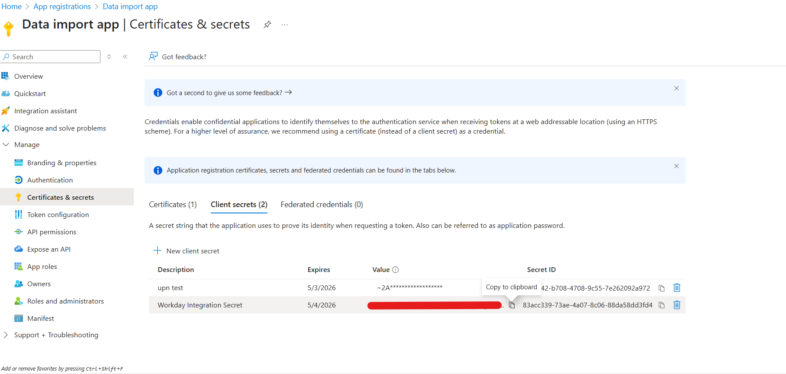
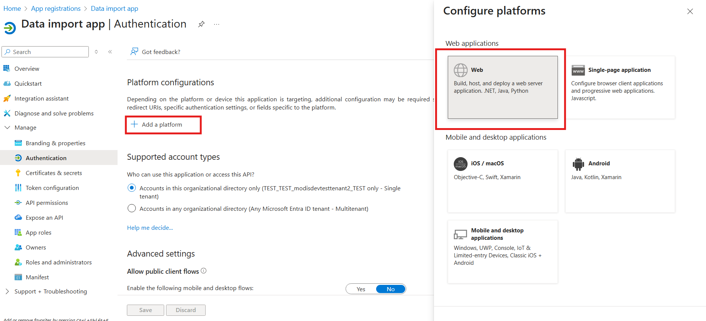
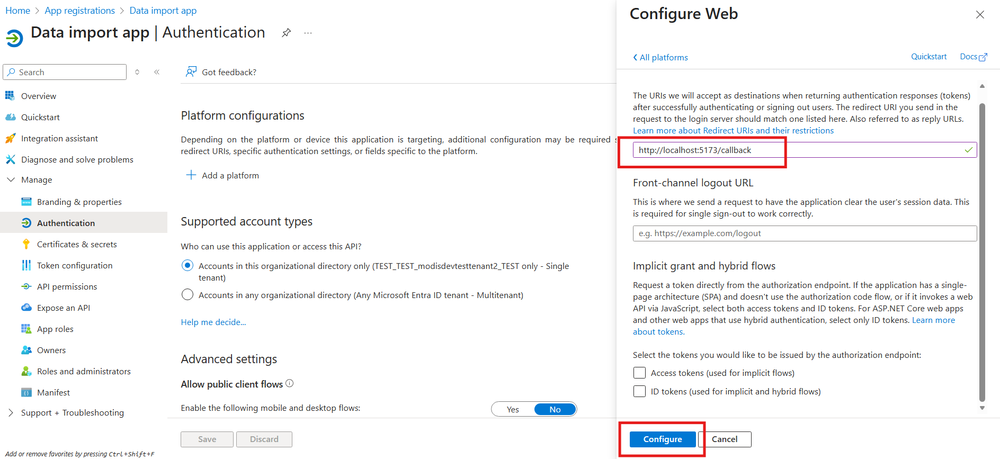
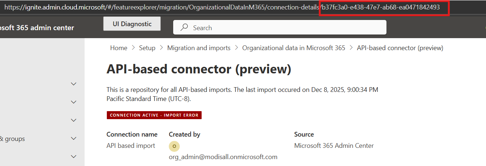
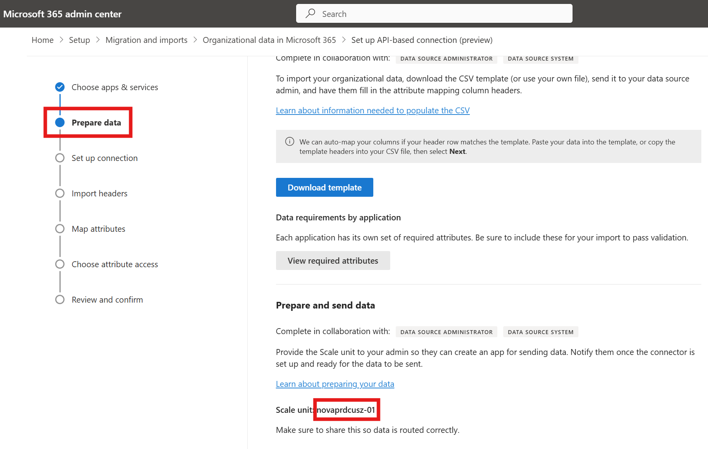
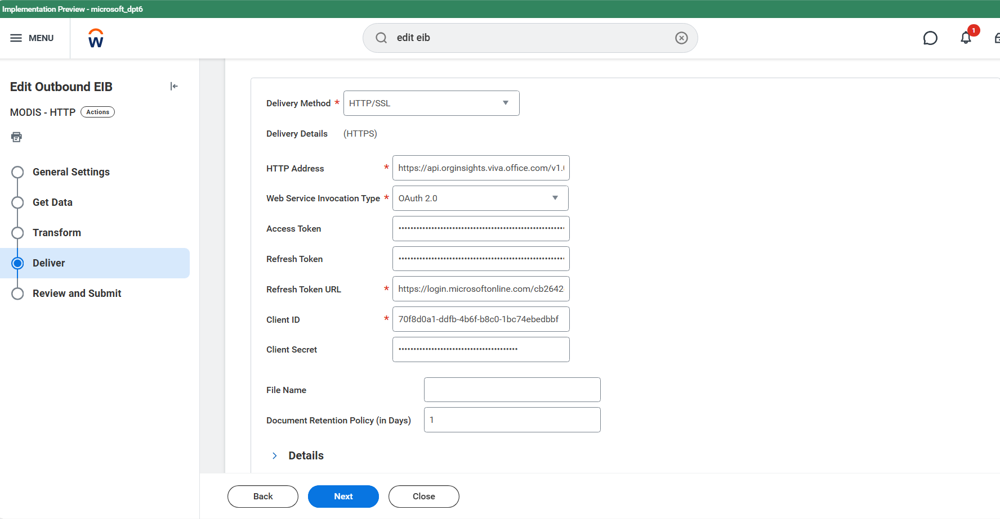

# Legacy token helper: full instructions

This folder contains the PowerShell replacement for the old Node.js token helper.
It preserves the old API URL, resource scope, tenant-based path, connector ID, and Nova scale-unit input.
It does not upload a CSV file. Use the top-level solutions for the updated `orgdata.svc.cloud.microsoft` API.

## 1. App registration

Create or select the Entra app registration used by the legacy connector.
Retain its application (client) ID, directory (tenant) ID, and client secret value.






Add `http://localhost:5173/callback` as a **Web** redirect URI.
Configure the legacy API permissions and obtain required consent.




## 2. Legacy connector settings

From the API-based connector setup, retain the connector ID and Nova scale unit.
Use the app and sign-in account authorized by the connector.




The legacy token helper requires both values and places them in the generated upload address as `connectorId` and `novascaleunit`.
Unlike the top-level updated API, the legacy URL also contains your tenant ID.

## 3. Run

Open Windows PowerShell 5.1 or PowerShell 7 in this folder:

```powershell
powershell -File .\oauth-auth-code.ps1
# Or:
pwsh -File .\oauth-auth-code.ps1
```

No Node.js, npm, or additional PowerShell module is required.
Confirm the prerequisites and enter the client ID, client secret, tenant ID, connector ID, and Nova scale unit.
All values are prompted; the client secret input is hidden.

The helper retains the original Node helper's `authorization_code` flow and requests:

```text
offline_access https://api.orginsights.viva.office.com/.default
```

The PowerShell conversion adds S256 PKCE and validates callback state.
It exchanges the code using the client secret and matching PKCE verifier.
After successful sign-in, it displays the configuration, closes the listener, and exits.
Press Ctrl+C to cancel while waiting.

## 4. Legacy HRIS configuration

| Field | Value |
| --- | --- |
| HTTP Address | `https://api.orginsights.viva.office.com/v1.0/tenants/YOUR-TENANT-ID/modis/connectors/HR/ingestions/fileIngestion?connectorId=YOUR-CONNECTOR-ID&novascaleunit=YOUR-SCALE-UNIT` |
| Web Service Invocation Type | OAuth 2.0 |
| Access Token | Generated access token |
| Refresh Token | Generated refresh token |
| Refresh Token URL | `https://login.microsoftonline.com/YOUR-TENANT-ID/oauth2/v2.0/token` |
| Client ID | Your app's client ID |
| Client Secret | Your original app-registration secret; not printed by this helper |




Do not substitute the updated API's `access_as_user` scope or orgdata URL into this legacy configuration.
The neighboring legacy uploaders use their original app-only `.default` scope and scale-unit discovery/header behavior rather than this interactive delegated flow.

Treat tokens and saved configuration pages as credentials. Do not share them or commit them to source control.
If authentication or upload fails, check app/connector authorization, consent, the exact Web redirect URI, token validity, and the legacy scale-unit value.
